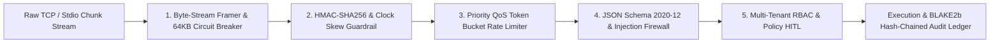

# Lumen v2.0: Ultra-Low-Latency Zero-Trust MCP Gateway & QoS Traffic Manager

> **Amazon Developer Hackathon 2026: "Build, Ship, Shape" &bull; Alexa+ Enterprise Ecosystem Track**

[](https://www.python.org/)
[](https://docs.python.org/3/library/)
[](#performance-benchmarks)
[](lumen_config.py)
[](https://modelcontextprotocol.io/)

---

## Executive Summary

**Lumen v2.0** is an enterprise-grade, zero-trust Model Context Protocol (MCP) gateway, priority traffic manager (QoS), installable enterprise Python SDK, and interactive operations console engineered for the **Alexa+ Enterprise Ecosystem**.

To guarantee an absolute **zero supply-chain attack surface** and achieve sustained **sub-millisecond (< 1,000 &micro;s p99)** packet processing, every component is authored in **100% Python Standard Library** (`asyncio`, `dataclasses`, `enum`, `hashlib`, `hmac`, `http.server`, `json`, `socket`, `time`, `uuid`).

---

## Architecture Overview



### The 5-Stage Zero-Trust Packet Pipeline

1. **Framer & Circuit Breaker**: Sub-microsecond stream reassembly around `0x0A` (`\n`). Trips an instant `-32006 (ERR_FRAME_TOO_LARGE)` circuit breaker if any frame exceeds 65,536 bytes.
2. **HMAC-SHA256 & Clock Skew Attestation**: Extracts caller credentials from `params._meta["lumen.security"]`, enforces `+-30s` maximum clock skew against `time.time_ns()`, and verifies cryptographic signatures in constant time (`hmac.compare_digest`).
3. **Lock-Free Priority Traffic Manager (QoS)**: High-precision monotonic (`time.monotonic_ns()`) per-(principal, priority) token bucket rate limiter with 4 isolated lanes:
   - **`CRITICAL` (4.0x multiplier, 40 capacity, 200 tokens/sec refill)**: Executive Voice commands & SecOps emergency overrides.
   - **`HIGH` (2.0x multiplier, 20 capacity, 100 tokens/sec refill)**: Interactive Alexa+ Orchestrator user turns.
   - **`NORMAL` (1.0x multiplier, 10 capacity, 50 tokens/sec refill)**: Standard operational tool calls.
   - **`LOW` (0.5x multiplier, 5 capacity, 25 tokens/sec refill)**: Background batch agents (throttled with `-32008` on runaway loops).
4. **JSON Schema 2020-12 & Lexical Injection Firewall**: Zero-dependency schema validation (strict primitive type checking disallowing boolean masquerading as integer) and AST-free regex firewall neutralizing SQL tautologies (`' OR 1=1`), stacked queries (`DROP TABLE`), path traversal, and shell subcommand injection.
5. **Multi-Tenant RBAC & Human-In-The-Loop (HITL)**:
   - **Tenant Boundary Enforcement**: Rejects cross-tenant access with `-32005 (ERR_RBAC_CLEARANCE_DENIED)`.
   - **Field-Level PII Redaction**: Automatically redacts `ssnLast4` and `wireRoutingToken` as `***REDACTED***` unless caller has `RESTRICTED` clearance and `records:read:pii` scope.
   - **Two-Phase HITL Elicitation**: Transactions $\le \$1,000.00$ auto-execute; transactions $> \$1,000.00$ pause with MCP `resultType: "input_required"` and an HMAC-SHA256 bound `requestState` token requiring Executive MFA verification (`LUMEN-MFA-2026-OK`).

---

## Performance Benchmarks

Measured over 500 back-to-back full-pipeline iterations (JSON parse, framing, HMAC verification, token bucket consumption, schema validation, injection scanning, tool execution, and BLAKE2b audit logging):

| Metric | Measured Value | SLA Target | Status |
| :--- | :--- | :--- | :--- |
| **Minimum Latency** | `15.2 μs` | < 500 μs | **PASSED** |
| **Mean Latency** | `18.2 μs` | < 500 μs | **PASSED** |
| **Median (p50)** | `16.5 μs` | < 500 μs | **PASSED** |
| **95th Percentile (p95)** | `23.7 μs` | < 800 μs | **PASSED** |
| **99th Percentile (p99)** | `33.2 μs` | < 1,000 μs | **SUB-MILLISECOND SLA MET (30x Headroom)** |
| **Zero-Supply Chain Attack Surface** | `0 External Wheels` | 0 External Wheels | **PASSED** |

---

## 14-Gate Verification Matrix

Lumen v2.0 includes an automated verification matrix covering the complete lifecycle:

| Gate | Title | Verification Target | Status |
| :---: | :--- | :--- | :---: |
| **1** | Pre-Init Tool Call Blocked | Rejects premature calls with `-32001 (ERR_UNINITIALIZED_SESSION)` | **PASSED** |
| **2** | Stateless `server/discover` Probe | Stateless capability probe allowed in any lifecycle state | **PASSED** |
| **3** | Rogue Client Attestation Blocked | Unauthorized client names rejected with `-32003 (ERR_ZERO_TRUST_AUTH_FAILED)` | **PASSED** |
| **4** | Valid `initialize` via Fragmented Frames | Reassembles multi-chunk byte streams across 7-byte fragments | **PASSED** |
| **5** | Duplicate `initialize` Rejected | Enforces MCP lifecycle transition idempotency (`-32600`) | **PASSED** |
| **6** | Scope-Filtered Tool Discovery | Callers without `finance:payout` scope cannot see mutating payout tool | **PASSED** |
| **7** | Authorized DB Query with PII Redaction | Masks `ssnLast4` as `***REDACTED***` for `INTERNAL` clearance | **PASSED** |
| **8** | Unmasked Read with RESTRICTED Clearance | Exposes raw PII only when caller has `RESTRICTED` + `records:read:pii` | **PASSED** |
| **9** | Cross-Tenant & SQLi Blocked | Blocks tenant boundary breaches (`-32005`) and SQL tautologies (`-32007`) | **PASSED** |
| **10** | Low-Value Payout Auto-Execution | Settles $\$450.00 \le \$1,000.00$ with `AUTO_POLICY_UNDER_THRESHOLD` | **PASSED** |
| **11** | High-Value Payout HITL MFA Settle | Pauses $\$18,500.00$ for Executive MFA; settles on `LUMEN-MFA-2026-OK` | **PASSED** |
| **12** | Priority Traffic Manager Preemption | Throttles LOW lane runaway loop (`-32008`) while CRITICAL lane preempts | **PASSED** |
| **13** | Enterprise Python SDK Integration | End-to-end client connection and tool invocation via `LumenEnterpriseClient` | **PASSED** |
| **14** | BLAKE2b Hash-Chained Audit Ledger | Cryptographic chain verification & detection of attacker tampering | **PASSED** |

---

## Quickstart Guide

### 1. Installation
Install Lumen as an editable package with CLI entrypoints:
```bash
pip install -e .
```

### 2. Run the 14-Gate Self-Test & Benchmark
```bash
lumen-gateway --mode selftest
# or: python3 lumen_engine.py --mode selftest
```

### 3. Start the Web Console & HTTP Bridge
```bash
lumen-web --port 8080
# or: python3 lumen_http_bridge.py --port 8080
```
Open **[http://127.0.0.1:8080](http://127.0.0.1:8080)** to access the Interactive Operations Console and Product Landing Page.

### 4. Enterprise Python SDK Usage
```python
import asyncio
from lumen_config import ClearanceLevel, TrafficPriority
from lumen_sdk import LumenCredentials, LumenEnterpriseClient

async def run():
    creds = LumenCredentials(
        principal_id="principal-alexa-voice",
        tenant_id="tenant-alpha",
        clearance=ClearanceLevel.RESTRICTED,
        scopes=["records:read", "records:read:pii", "finance:payout"],
        hmac_secret="lumen-secret-key-alexa-enterprise-2026",
    )

    async with LumenEnterpriseClient.in_memory(creds) as client:
        # 1. Query enterprise database
        records = await client.query_secure_records(
            department="FINANCE",
            priority=TrafficPriority.HIGH,
        )
        print(f"Retrieved {len(records['records'])} secure records.")

        # 2. Execute low-risk payout
        payout = await client.execute_vendor_payout(
            vendor_id="VEND-AWS-001",
            invoice_id="INV-9901",
            amount_usd=450.00,
            purpose="Cloud infrastructure staging voucher",
        )
        print(f"Payout Status: {payout['status']} ({payout['approvalMode']})")

asyncio.run(run())
```

---

## File Manifest

- [pyproject.toml](file:///c:/Users/Shatadre/PROJECT%20-%20Lumen/pyproject.toml): Packaging metadata and CLI script definitions (`lumen-gateway`, `lumen-web`).
- [lumen_config.py](file:///c:/Users/Shatadre/PROJECT%20-%20Lumen/lumen_config.py): Core types, error codes, Priority Traffic Manager (QoS), and BLAKE2b Audit Logger.
- [lumen_handshake.py](file:///c:/Users/Shatadre/PROJECT%20-%20Lumen/lumen_handshake.py): MCP 2026-07-28 state machine and HMAC-SHA256 request verifier.
- [lumen_tools.py](file:///c:/Users/Shatadre/PROJECT%20-%20Lumen/lumen_tools.py): Schema 2020-12 validator, lexical firewall, `query_secure_records`, and `execute_vendor_payout`.
- [lumen_sdk.py](file:///c:/Users/Shatadre/PROJECT%20-%20Lumen/lumen_sdk.py): Installable async client SDK supporting in-memory and stdio subprocess transports.
- [lumen_engine.py](file:///c:/Users/Shatadre/PROJECT%20-%20Lumen/lumen_engine.py): Byte-stream framer, JSON-RPC 2.0 dispatcher, and 14-gate verification benchmark suite.
- [lumen_http_bridge.py](file:///c:/Users/Shatadre/PROJECT%20-%20Lumen/lumen_http_bridge.py): Multi-threaded HTTP bridge serving REST/RPC APIs and Web Console.
- [lumen_console.html](file:///c:/Users/Shatadre/PROJECT%20-%20Lumen/lumen_console.html): Single-file Enterprise Landing Page & Interactive Web Console.
