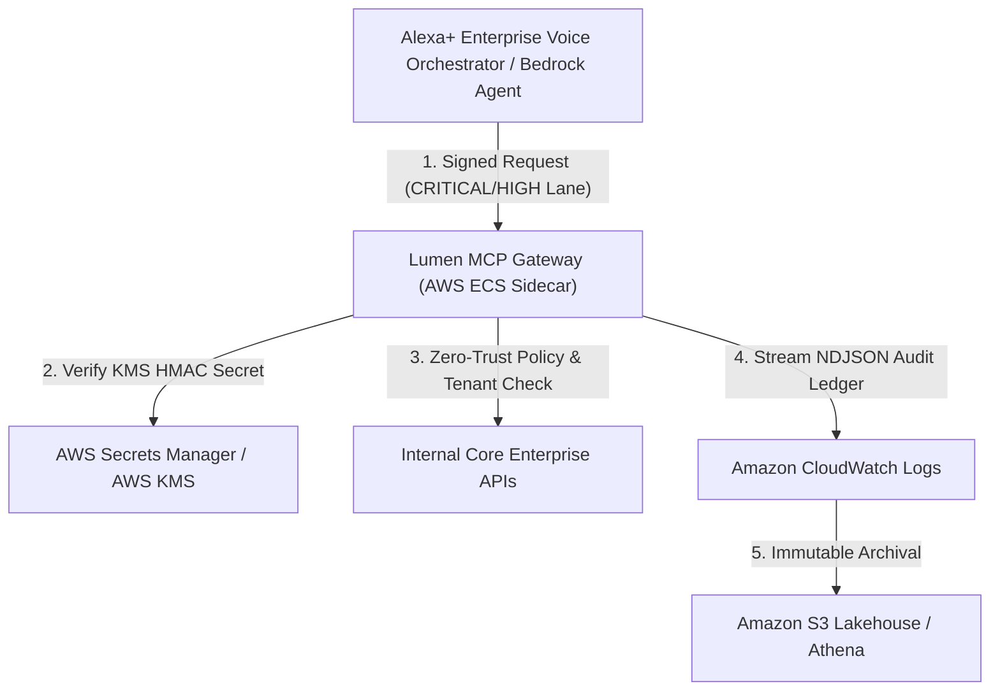

# Lumen v2.0 Enterprise Client Integration Manual
**Amazon Developer Hackathon 2026: "Build, Ship, Shape" (Alexa+ Enterprise Ecosystem)**

This guide provides enterprise software architects and security engineers with integration instructions for connecting internal microservices, Amazon Bedrock AI Agents, and the Alexa+ Enterprise Voice Orchestrator to the Lumen v2.0 Zero-Trust Gateway.

---

## 1. Overview of Integration Modes

| Mode | Target Runtime | Protocol / Transport | Primary Use Case |
| :--- | :--- | :--- | :--- |
| **Mode A: MCP Host Stdio** | Claude Desktop, Bedrock Developer CLI, Cursor | Stdio JSON-RPC 2.0 Subprocess | Local tool discovery and desktop agent development |
| **Mode B: Python Client SDK** | Microservices, AWS Lambda, ECS Fargate | In-Memory Zero-Copy or Child Process IPC | Production server-to-server zero-trust tool execution |
| **Mode C: Proprietary ML Plugin** | Enterprise Risk & Fraud Systems | In-Process ToolRegistry Registration | Injecting internal ML inference models behind Zero-Trust guardrails |

---

## 2. Mode A: Drop-In MCP Client Config (`mcp_config.json`)

To connect standard Model Context Protocol hosts (e.g., Claude Desktop, MCP CLI, or local developer orchestrators) to Lumen, point your MCP host configuration to [`mcp_config.json`](file:///c:/Users/Shatadre/PROJECT%20-%20Lumen/mcp_config.json):

```json
{
  "mcpServers": {
    "lumen-zero-trust-enterprise": {
      "command": "python3",
      "args": ["lumen_engine.py", "--mode", "stdio"],
      "env": {
        "PYTHONUNBUFFERED": "1",
        "LUMEN_ENVIRONMENT": "production",
        "LUMEN_HMAC_SECRET": "lumen-secret-key-alexa-enterprise-2026"
      }
    }
  }
}
```

The gateway immediately surfaces authorized enterprise tools (`query_secure_records`, `execute_vendor_payout`, etc.) over standard JSON-RPC 2.0 framing.

---

## 3. Mode B: Enterprise Python Client SDK (`lumen_sdk.py`)

Install Lumen as an editable package or vendor the 100% standard library modules:

```bash
pip install -e .
```

### In-Memory Zero-Copy Execution (Sub-Millisecond p99 < 35 µs)

```python
import asyncio
from lumen_config import ClearanceLevel, TrafficPriority
from lumen_sdk import LumenCredentials, LumenEnterpriseClient

async def run_client():
    creds = LumenCredentials(
        principal_id="principal-alexa-voice-orchestrator",
        tenant_id="tenant-alpha",
        clearance=ClearanceLevel.RESTRICTED,
        scopes=["records:read", "records:read:pii", "finance:payout"],
        hmac_secret="lumen-secret-key-alexa-enterprise-2026",
    )

    async with LumenEnterpriseClient.in_memory(creds) as client:
        # Query read-only records with unmasked PII
        records = await client.query_secure_records(
            department="FINANCE",
            priority=TrafficPriority.HIGH,
        )
        print("Records retrieved:", len(records["records"]))

        # Execute financial payout (< $1,000 auto-approved; > $1,000 pauses for HITL)
        payout = await client.execute_vendor_payout(
            vendor_id="VEND-AWS-001",
            invoice_id="INV-9904",
            amount_usd=450.00,
            purpose="Cloud infrastructure capacity burst",
            priority=TrafficPriority.NORMAL,
        )
        print("Payout settled:", payout["payoutId"], payout["approvalMode"])

asyncio.run(run_client())
```

---

## 4. Mode C: Custom Enterprise ML Plugin (`lumen_custom_plugin_demo.py`)

Enterprise clients can inject custom proprietary machine learning models directly into Lumen's `ToolRegistry`. The gateway automatically wraps custom tools with JSON Schema validation, SQLi/Shell lexical firewalls, tenant isolation, and field masking:

```python
from lumen_config import ClearanceLevel, LumenConfig, ToolName
from lumen_handshake import SecurityContext
from lumen_tools import ToolDefinition, ToolRegistry

def handle_run_fraud_detection_model(arguments: dict, sec_ctx: SecurityContext, config: LumenConfig) -> dict:
    cardholder_ip = arguments["cardholderIp"]
    # Enforce field-level privacy: mask IP unless caller has RESTRICTED clearance
    masked_ip = cardholder_ip if sec_ctx.clearance >= ClearanceLevel.RESTRICTED else "***.***.***.REDACTED"
    return {
        "transactionId": arguments["transactionId"],
        "fraudScore": 0.28,
        "verdict": "ALLOW",
        "cardholderIp": masked_ip,
    }

# Register into the ToolRegistry
registry = ToolRegistry(LumenConfig())
registry.register(
    ToolDefinition(
        name=ToolName("run_fraud_detection_model"),
        description="Proprietary Enterprise ML inference tool assessing transaction fraud risk.",
        input_schema={
            "type": "object",
            "properties": {
                "tenantId": {"type": "string"},
                "transactionId": {"type": "string"},
                "amountUsd": {"type": "number"},
                "cardholderIp": {"type": "string"},
            },
            "required": ["tenantId", "transactionId", "amountUsd", "cardholderIp"],
            "additionalProperties": False,
        },
        required_scope="ml:fraud:score",
        min_clearance=ClearanceLevel.CONFIDENTIAL,
        handler=handle_run_fraud_detection_model,
    )
)
```

Run the complete self-testing demo:
```bash
python3 lumen_custom_plugin_demo.py
```

---

## 5. AWS Enterprise Cloud Integration Architecture



### AWS IAM Roles & Permissions
Attach the following IAM policy to the Lumen ECS task execution role (`arn:aws:iam::123456789012:role/LumenMcpGatewayExecutionRole`):

```json
{
  "Version": "2012-10-17",
  "Statement": [
    {
      "Sid": "AllowKmsHmacSecretAccess",
      "Effect": "Allow",
      "Action": [
        "secretsmanager:GetSecretValue",
        "kms:Decrypt",
        "kms:GenerateDataKey"
      ],
      "Resource": [
        "arn:aws:secretsmanager:us-east-1:123456789012:secret:lumen/hmac-key-*",
        "arn:aws:kms:us-east-1:123456789012:key/lumen-hmac-sha256-key-2026"
      ]
    },
    {
      "Sid": "AllowCloudWatchAuditStreaming",
      "Effect": "Allow",
      "Action": [
        "logs:CreateLogStream",
        "logs:PutLogEvents",
        "logs:DescribeLogStreams"
      ],
      "Resource": "arn:aws:logs:us-east-1:123456789012:log-group:/aws/ecs/lumen-enterprise-gateway:*"
    }
  ]
}
```

### AWS Bedrock Agents OpenAPI & Action Group Binding
Export the Bedrock integration bundle from Lumen:
```bash
curl -s http://127.0.0.1:8080/api/export?format=aws_bedrock > lumen_aws_bedrock_alexa_bundle.json
```
Use this JSON bundle in the AWS Management Console or AWS CLI to bind Lumen tools as an **Amazon Bedrock Agent Action Group**.

### Amazon CloudWatch Logs & Amazon S3 Audit Archival
The BLAKE2b audit chain streams continuous NDJSON records to stderr and can be exported directly:
```bash
curl -s http://127.0.0.1:8080/api/export?format=ndjson > lumen_audit_stream.ndjson
```
These records feed into an Amazon S3 Lakehouse table queried via Amazon Athena for SOC2 / ISO-27001 continuous compliance audits:
```sql
SELECT index, timestampNs, event, principalId, tenantId, status, currentHash
FROM lumen_audit_lakehouse
WHERE status != 'SUCCESS'
ORDER BY timestampNs DESC;
```
